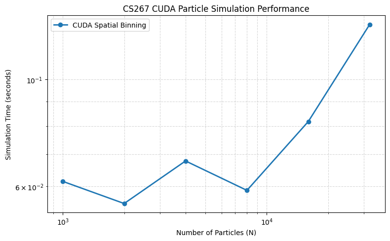
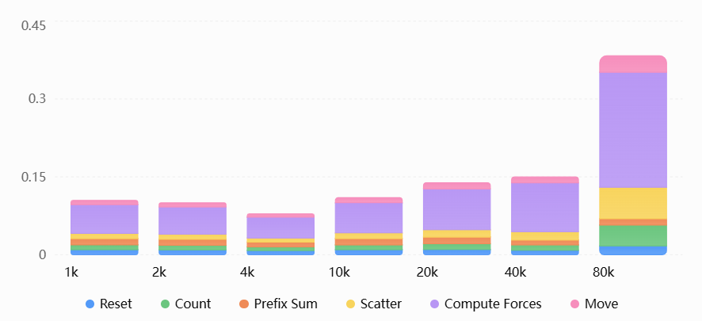

# 1.performance and implementation

## perfromance before implementation
### theoretical complexity
- By the saying in the assignment description, if we compute the forces on the particles 
by iterating through every pair of them, we would have time O(n^2).
- In this assignment, we hope to achieve O(n) interactions.

### original implementation
every thread is responsible for 1 particle, 
every particle computes its ax ay with all particles one by one.

The following is the running time before any modification.
```bash
-n <int>: set number of particles
-o <filename>: set the output file name
-s <int>: set particle initialization seed
Simulation Time = 0.732337 seconds for 1000 particles.
Simulation Time = 1.19536 seconds for 2000 particles.
Simulation Time = 2.29949 seconds for 4000 particles.
Simulation Time = 5.62793 seconds for 10000 particles.
```

## After implementation
### theoretical analysis
I decided to implement Spatial Binning: giving a bounding box of size cutoff, 
only compute the particles inside that cutoff.

Description of the data structures: Arrays r used to acheieve this goal.
- cell_counts: number of particles in a cell
- cell_offset: records the first particle position in a cell
  -  (use Prefix Sum to compute this offset)
- cell_particles: exact particle in a cell
- cell_write_counts: record the # of particles insert into one cell, avoid race conditions

The implementation details are: 
- 1.sent each paticle to a thread on GPU,compute their corresponding cell_ids,
increment the cell_count[cell_id]
- 2.compute the starting index(cell_offset) according to cell_count
- 3.add paticles into cell_particles using cell_write_counts

### results
- A plot in the log-log scale showing your parallel codes performance 


# 2.Description of the synchronization I used in the GPU implementation.
The synchornization is both at the function calling level and at the atomic change of global variables. 
For example, particle counts are computed in parallel by compute_cell_gpu.
The prefix sum is performed only after the counting kernel finishes.
Additionally, atomicAdd() is used in compute_cell_gpu and scatter_particles_gpu 
to prevent race conditions when multiple threads update the same cell.

# 3.Description of the design choices that I tried and how did they affect the performance.
- First, I assigned each particle to a CUDA thread to compute its cell ID in parallel. Each thread uses atomicAdd() to update the particle count of its corresponding cell.
- Second, I used the CUB library to compute an exclusive prefix sum on the GPU, obtaining the starting offset of each cell in the cell_particles array.
- Third, I assigned each particle to a CUDA thread again to insert its particle ID into cell_particles. I used an auxiliary array, cell_write_counts, and atomicAdd() to prevent race conditions.
- Fourth, I assigned each particle to a CUDA thread to compute its acceleration by checking only the particles in its own cell and the eight neighboring cells. Finally, another CUDA kernel updates each particle's velocity and position.

Performance Impact: Spatial binning reduces unnecessary particle-pair checks compared with the original (O(N^2)) implementation. My experiments showed a significant reduction in simulation time, especially for larger particle counts. However, building the spatial grid introduces additional overhead, including atomic operations and prefix sum computation.

# 4. runtime analysis
- break down the runtime into computation time, synchronization time and/or communication time 
- how do they scale with the number of particles?


I used CUDA Events to measure the average execution time of six stages: Reset, Count, Prefix Sum, Scatter, Compute Forces, and Move.

Computation: Compute Forces was the most time-consuming stage, accounting for approximately 51%–63% of the measured stage time.
Count and Scatter became more expensive as the particle count increased, while Prefix Sum remained relatively stable.

Scaling: The total measured stage time increased from 0.139 ms at 20,000 particles to 0.383 ms at 80,000 particles. Although the particle count increased by a factor of four, the runtime increased by approximately 2.76 times. This suggests improved scaling compared with the original quadratic pairwise algorithm over this measured range.

```text
=== Runtime Breakdown ===
Reset           : 0.009607 ms
Count           : 0.009382 ms
Prefix Sum      : 0.012004 ms
Scatter         : 0.010074 ms
Compute Forces  : 0.055392 ms
Move            : 0.008371 ms
GPU total/step  : 0.104829 ms
Simulation Time = 0.114599 seconds for 1000 particles.

=== Runtime Breakdown ===
Reset           : 0.009305 ms
Count           : 0.008871 ms
Prefix Sum      : 0.011505 ms
Scatter         : 0.009814 ms
Compute Forces  : 0.052507 ms
Move            : 0.008025 ms
GPU total/step  : 0.100027 ms
Simulation Time = 0.109855 seconds for 2000 particles.

=== Runtime Breakdown ===
Reset           : 0.007996 ms
Count           : 0.007051 ms
Prefix Sum      : 0.009327 ms
Scatter         : 0.007759 ms
Compute Forces  : 0.040136 ms
Move            : 0.006450 ms
GPU total/step  : 0.078717 ms
Simulation Time = 0.0881041 seconds for 4000 particles.

=== Runtime Breakdown ===
Reset           : 0.009615 ms
Count           : 0.009213 ms
Prefix Sum      : 0.012214 ms
Scatter         : 0.011159 ms
Compute Forces  : 0.058094 ms
Move            : 0.009538 ms
GPU total/step  : 0.109832 ms
Simulation Time = 0.119683 seconds for 10000 particles.

=== Runtime Breakdown ===
Reset           : 0.010016 ms
Count           : 0.011171 ms
Prefix Sum      : 0.012775 ms
Scatter         : 0.014197 ms
Compute Forces  : 0.078561 ms
Move            : 0.011985 ms
GPU total/step  : 0.138704 ms
Simulation Time = 0.148889 seconds for 20000 particles.

=== Runtime Breakdown ===
Reset           : 0.008545 ms
Count           : 0.010291 ms
Prefix Sum      : 0.009410 ms
Scatter         : 0.016088 ms
Compute Forces  : 0.094115 ms
Move            : 0.011466 ms
GPU total/step  : 0.149915 ms
Simulation Time = 0.158972 seconds for 40000 particles.

=== Runtime Breakdown ===
Reset           : 0.016973 ms
Count           : 0.040120 ms
Prefix Sum      : 0.012246 ms
Scatter         : 0.060569 ms
Compute Forces  : 0.221564 ms
Move            : 0.031865 ms
GPU total/step  : 0.383336 ms
Simulation Time = 0.393201 seconds for 80000 particles.
```

------------------------------------------------------------------
# environment configuration in WSL Ubuntu:
```bash
cd /tmp
wget https://developer.download.nvidia.com/compute/cuda/repos/ubuntu2404/x86_64/cuda-keyring_1.1-1_all.deb
sudo dpkg -i cuda-keyring_1.1-1_all.deb
sudo apt update
sudo apt install -y cuda-toolkit-13-0
echo 'export PATH=/usr/local/cuda-13.0/bin:$PATH' >> ~/.bashrc
echo 'export CUDA_HOME=/usr/local/cuda-13.0' >> ~/.bashrc
source ~/.bashrc
# check if the CUDA Toolkit is successfully installed
nvcc --version
ls /usr/local/cuda-13.0/include/cuda.h
```
press left CTRL + left click on mouse to jump to a definition

------------------------------------------------------------------
记录关于GPU的知识：
# 一、Thread 负责计算，Warp 负责硬件执行，Block 负责组织协作与调度，Grid 代表整个 Kernel 的线程集合
# 二、block的作用
## 1. scheduling
- GPU 以 Block 为单位，将线程分配到不同的 Streaming Multiprocessors（SM）上执行。
- 一个 Block 的线程在同一个 SM 上运行，但不一定同时执行
## 2. shared mem
- 同一个 Block 内的线程可以利用高速 Shared Memory 交换数据，减少访问较慢的 Global Memory
## 3. synchronization
- 同一个 Block 内的线程可以使用：__syncthreads()在一个同步点等待同一个 Block 中的其他线程

# 三、warp
Warp 是 GPU 实际执行和调度指令的重要单位，同一 Warp 的线程以 SIMT 方式执行

# 四、有关GPU的代码
- __device__: function runs on GPU and can only be called from the GPU
- __global__: function runs on GPU and can be called from the CPU
- GPU Kernel cannot read CPU global variables